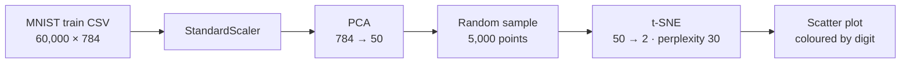

# 🔢 Seeing MNIST in 2D: PCA → t-SNE

**Compressing 60,000 handwritten digits from 784 dimensions to 2, so the ten digit classes show up as separate clusters.**

---

## The question

Each MNIST image is 28 × 28 = **784 pixel features**. Can we squeeze that down to **2 numbers per image** and still see that a "3" is not a "7"?

## Pipeline

| Step | Why |
|---|---|
| **Standardise** | PCA is variance-driven, so pixels need a common scale |
| **PCA to 50 components** | Removes noise and makes t-SNE much faster, which is the standard practice before t-SNE on high-dimensional data |
| **Sample 5,000 points** | t-SNE is roughly O(n²), and 5,000 points still show the structure clearly |
| **t-SNE to 2D** (`perplexity=30`, `random_state=42`) | Keeps *local* neighbourhoods, so similar digits land next to each other |

## What you see

Ten mostly separate clusters, one per digit. Visually similar digits (4 and 9, 3 and 5, 7 and 1) sit next to each other or overlap a little, which is exactly where a classifier would find it hardest.

**PCA vs t-SNE in one line:** PCA is a linear projection that keeps global variance. t-SNE is a non-linear embedding that keeps local neighbourhoods. Running PCA first and t-SNE second gives you both speed and clear clusters.

## Run it

Open the notebook in Colab with the badge above, upload `mnist_train.csv` (the [Kaggle MNIST CSV](https://www.kaggle.com/datasets/oddrationale/mnist-in-csv)), and run all cells.

> `model.py` in this repo is a small MobileNetV2 + Streamlit image-classifier demo. Its full version lives in [ai-image-classifier](https://github.com/kartikeyajay2006/ai-image-classifier).

## Author

**[Kartikeya Yadav](https://github.com/kartikeyajay2006)** · [LinkedIn](https://www.linkedin.com/in/kartikeya2006/)
